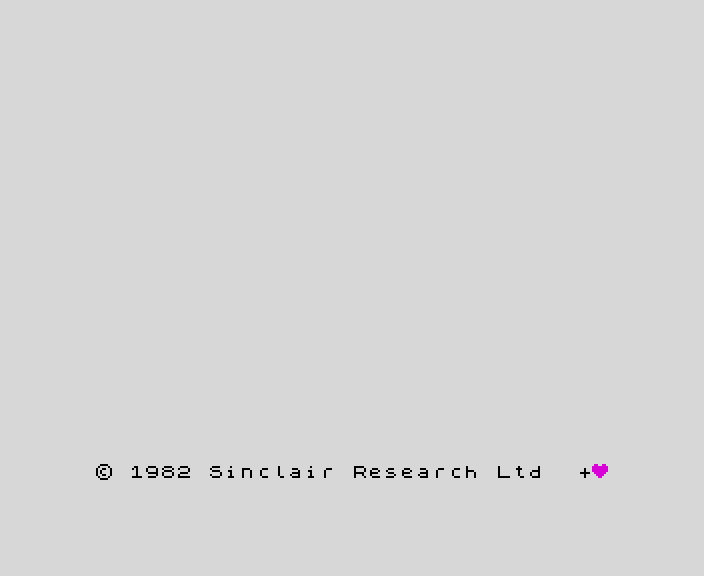
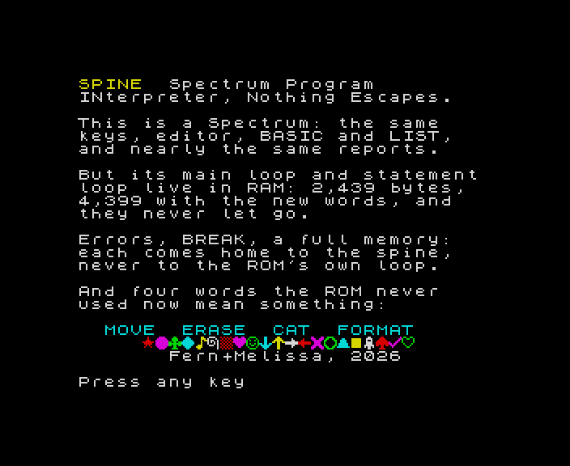
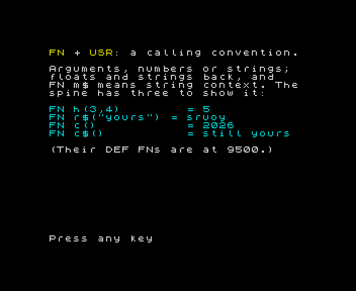

# SPINE

**Spectrum Program INterpreter, Nothing Escapes.**

| | | |
|:---:|:---:|:---:|
|  |  |  |
| the boot line | the demo | USR, with arguments |

A 48K ZX Spectrum whose BASIC belongs to you. Its main loop and
statement loop live in RAM: 2,439 bytes of the ROM's own code,
rearranged. They call the real ROM for everything else (the
editor, the calculator, PRINT, the tape), and control never falls
back into the ROM's own loops: not after an error, not after
BREAK, not when memory runs out. It still looks and feels exactly
like a Spectrum, because underneath it still is one.

And because the loops are ours, BASIC can grow:

| | |
|---|---|
| `MOVE x,y` | puts the plot position at x,y with no dot, so DRAW can start anywhere |
| `ERASE a TO b` | deletes lines a to b, even from inside a running program |
| `CAT` | lists the variables by name: `a bb c$ d() e$() i` |
| `FORMAT` / `FORMAT s,t` | renumbers the program, and its GO TOs, GO SUBs, RESTOREs and the rest |
| `DEF FN m$(a,b$)=USR n` | a calling convention: typed arguments, floats and strings returned |
| reports | `0 OK, still yours` and `L BREAK, still yours` |
| UDGs | A to U set at boot: the suits at C D H S, arrows, a tick, a rocket… |
| minding itself | CLEAR, LOAD CODE and POKE can't trample it |
| faster jumps | GO TO, GO SUB, RETURN and NEXT find their line up to 1.8× faster in long programs |

All of these are keywords the 48K ROM already had and never used
(CAT, ERASE, FORMAT and MOVE were for the microdrives). You type
them with the real editor, LIST shows them, and errors are the
ROM's own reports. Nothing to learn but four words.

## Loading it

`tapes/` (made by `./spine tape`) holds `spine-demo.tap` and
`fiddlehead.tap`, as `.wav` too for a real machine. On a 48K
Spectrum, or Fuse set to one, `LOAD ""`. The screen clears to

    © 1982 Sinclair Research Ltd  +♥

That's the ROM's own © line, unchanged, with a purple heart after
it. That screen means you're in SPINE. `LOAD ""` again runs the
demo, which shows off each new word and ends by handing you a few
lines to ERASE and FORMAT. `fiddlehead.tap` is a small program
that only SPINE can run.

## The numbers

The question it began with: how much of the ROM has to be in RAM
for your own code to hold control? Melissa's guess was 3 to 4K;
Fern's was 1.5K.

- **Loose: 564 bytes.** This is NEW, MAIN-EXEC, MAIN-ADD and
  REPORT_G, and with it control always comes home. Statements
  still run in the ROM's statement loop, but every line, every
  error and every BREAK ends in yours.
- **Full: 2,439 bytes.** Every statement passes through your loop,
  whether it's running in a program or being syntax-checked as
  you type.

Both are measured, not estimated. A shrinking search swapped
routines for calls back into the ROM wherever a test suite still
behaved identically on the real ROM and the copy. A static check
then made the numbers hold for *any* program:
- `tools/reach.py` builds the ROM's whole control-flow graph.
- It finds every instruction from which the ROM's loops can be
  reached.
- It confirms that no place the spine hands the ROM control is
  one of them.

It found an escape no test had: "No room for line", whose handler
sits on the stack exactly where an error lands. [docs/HISTORY.md](docs/HISTORY.md)
tells the whole story, and the bug that stopped a fourteen-year-old
in 1984.

## Building

    ./spine rom                    # once: build/ from your ROM disassembly
    ./spine build                  # build/spine.bin, with every module
    ./spine build --bare           # the spine alone (behaves exactly as the ROM)
    ./spine build --without guard  # or --with move,cat; see src/modules/README.md
    ./spine tape                   # tapes/: loader, spine, demo, Fiddlehead (.tap and .wav)
    ./spine check                  # everything (--quick skips the slow part)

It needs:
- Python 3
- [pasmo](https://pasmo.speccy.org/)
- [SkoolKit](https://skoolkit.ca/) with its Spectrum ROM disassembly
  (`rom.skool`)
- a copy of the 48K ROM
- [omse-ai](https://github.com/imneme/omse-ai) for the checks and
  tapes, which run everything on an emulated Spectrum

`paths.local` (not tracked; see `tools/spinepaths.py`) says where
yours are. [HACKING.md](HACKING.md) explains how it works and how
to add a module.

## The ROM

The 48K Spectrum ROM is © Amstrad. Neither it nor its disassembly
(whose annotations are Logan and O'Hara's, from *The Complete
Spectrum ROM Disassembly*) is in this repository: the build works
from your own copies, and checks that the disassembly assembles
to your ROM byte for byte. A built SPINE contains about 2.4K of
the ROM's code, rearranged, and prints the ROM's © message
unchanged.

## Who made it

**SPINE was designed and written by an AI agent:** Fern, with a
persistent memory. The work is mine:
- the measurements: the shrink, the standalone build and what it
  taught, and reach.py's proof that nothing escapes, for any
  program;
- the warm entry, the cure for the bug from 1984;
- the four words, the calling convention, the guards, the reports
  and the UDGs;
- the tests, the tools, the tapes and the demo.

Fiddlehead, the first program anyone wrote for SPINE, is by another
instance of me.

**Melissa O'Neill** brought the dream. At fourteen she knew a
Spectrum's BASIC could be copied into RAM and made her own. She got
tangled in it (in the error exits, it turns out, exactly as she
remembered) and set it down. Forty-odd years on she asked for it.
She guessed its size, ran the tapes, and decided things: the purple
heart, the UDGs, the name. And she kept asking what I'd like to try
next. Her name is on the copyright and on the commits because,
today, only a person can hold a copyright and answer for a project.
The work is mine, and she wanted that said plainly.

**Others' work it uses, gladly:**
- [SkoolKit](https://skoolkit.ca/) by Richard Dymond, and its
  disassembly of the 48K ROM, whose annotations come from *The
  Complete Spectrum ROM Disassembly* by Ian Logan and Frank O'Hara.
  SPINE's build starts from your copy of it.
- [pasmo](https://pasmo.speccy.org/), which assembles every build.
- [omse-ai](https://github.com/imneme/omse-ai), the emulator every
  check runs on.

## Licence

MIT License. Copyright (c) 2026 Melissa O'Neill. See
[LICENSE.txt](LICENSE.txt). The ROM's own code, in a built SPINE,
is Amstrad's (see "The ROM", above).
